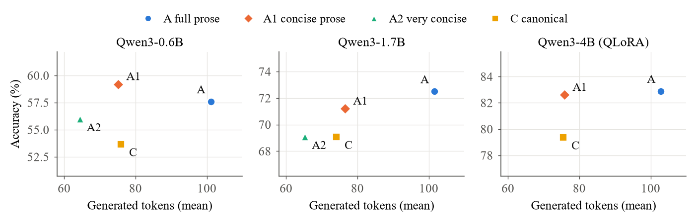

# Compress the Prose, Not the Language

**Linguistic Redundancy in Memorization and Reasoning of Small Transformers**

Code, generated data, per-problem outputs and reports for the paper
[`paper/compress_the_prose.pdf`](paper/compress_the_prose.pdf) (Marco Abbattista, November 2026).

## Abstract

Natural language carries redundancy (function words, agreement, restatement) that looks superfluous to a model. We ask
whether removing it lets transformers store the same facts with fewer parameters, train faster, or reason with fewer
tokens. In a controlled memorization setting (20,000 synthetic biographies, models trained from scratch at 0.15–8M
parameters), compression does not change the capacity needed at saturation, which is set by the facts (about 1–2 bits
per parameter). It shortens training to 0.55–0.86× the time, and lowers parameters mid-curve only when the compressed
form is regular and keeps the words that distinguish relations. In reasoning (GSM8K, Qwen3 0.6B/1.7B/4B with LoRA),
designed formats (telegraphic stripping, a canonical equation language) lose 2–4 accuracy points at every scale.
Concise natural prose instead matches full chain-of-thought accuracy with 25–26% fewer tokens and up to 27% lower
latency. Filler can be removed; numbers and relational words carry the information.

## Main results

- **Memorization (part 1):** at 90% recall every compressed format needs 0.95–1.01× the parameters of full prose.
  Compression only speeds up training (time to 90% recall 0.55–0.86×).
- **Reasoning (part 2):** concise prose (A1) matches full chain-of-thought (A) with about 25% fewer tokens at all
  three scales. At equal length it beats the canonical equation language (C) by 5.5, 2.1 and 3.3 points
  (McNemar p < 1e-11, 0.03, 0.006).
- The canonical format's gap to A stays at 3.4–4.0 points from 0.6B to 4B: the loss comes from the representation, not
  from model capacity.

GSM8K test accuracy (%) / mean generated tokens, all with calculator (C also grammar-constrained).
Seeds: 3 (0.6B), 2 (1.7B), 1 (4B, QLoRA).

| Format | Qwen3-0.6B | Qwen3-1.7B | Qwen3-4B |
|---|---|---|---|
| A full prose | 57.6 / 101 | 72.5 / 102 | 82.9 / 103 |
| A1 concise prose | **59.2** / 75 | 71.2 / 76 | 82.6 / 76 |
| A2 very concise | 56.0 / 64 | 69.1 / 65 | – |
| C canonical language | 53.7 / 76 | 69.1 / 74 | 79.4 / 76 |
| D answer only (no calculator) | 16.4 / 3 | 23.5 / 3 | – |



## Repository structure

```
paper/                    paper (PDF, LaTeX source), Figure 1 (fig_frontier.pdf/.png) and make_figure.py
part1_memorization/       experiments v1–v4: transformers trained from scratch on synthetic biographies
  src/                    v1 modules (config, data, model, pipeline, report); src/v2, src/v3, src/v4
  tests/                  pytest suite (v1 at top level, then v2/, v3/, v4/)
  scripts/                probes and benchmarks used by v3/v4
  run.py                  v1 orchestrator;  control_steps.py  v1 equal-steps control
  run_v2.py, run_v2_plan.py, run_v3_plan.py, run_v4_plan.py
  results/                CSVs and plots (v1 at top level, results/v2 … results/v4)
  training_logs/          per-run loss curves (log.csv), without checkpoints
  REPORT_v1.md … REPORT_v4.md
part2_reasoning/          experiments v5–v7: Qwen3 + LoRA on GSM8K
  src/                    formats, rewriting/verification, training, evaluation, grammar, calculator, analysis
  tests/                  pytest suite
  scripts/                GSM8K download, llama.cpp server launchers, v7 generator and phase scripts
  run_v5.py, run_v6.py, run_v7.py
  data/rewrites/          every generator attempt for A, C, C6, A1, A2 (with verification outcome)
  data/sft/               training sets per format, and the test set
  results/v5 … v7/        runs.csv, summary/comparison CSVs, plots, error analysis, per-problem outputs
  training_logs/          per-adapter train.json (loss, time), without adapter weights
  REPORT_v5.md … REPORT_v7.md
```

The reports, code comments and CLI help are in Italian. The reports were written while the experiments ran, when
part 2 lived in a folder named `v5/`: a path such as `v5/run_v7.py` in a report corresponds to
`part2_reasoning/run_v7.py` here, and `results/v7/` to `part2_reasoning/results/v7/`.

## Requirements

What the experiments actually ran on:

- Windows 11, NVIDIA RTX 4070 SUPER (12 GB), CUDA 12.4 drivers
- Python 3.11.9, PyTorch 2.6.0+cu124, `triton-windows` (for `torch.compile` in part 1)
- Hugging Face `transformers`, `peft`, `bitsandbytes` (QLoRA, 4B model), `datasets`
- spaCy with `it_core_news_sm` (Italian stripper, v3)
- [llama.cpp](https://github.com/ggml-org/llama.cpp) server (build b12211, CUDA) with
  `unsloth/Qwen3-4B-Instruct-2507-GGUF` Q8_0, only to regenerate the GSM8K rewrites

```powershell
py -3.11 -m venv .venv
.venv\Scripts\python -m pip install -r requirements.txt
```

The phase scripts in `part2_reasoning/scripts/*.sh` expect this venv at the repository root (override with
`PY=...`) and run under Git Bash. Disk space: the part 1 corpora regenerate to about 18 GB and the checkpoints take
about 8 GB; the part 2 adapters take about 2.4 GB.

Run the tests (each part is its own pytest root, because both have a `src` package):

```powershell
cd part1_memorization; ..\.venv\Scripts\python -m pytest -q   # 197 tests, ~2.5 min
cd ..\part2_reasoning;  ..\.venv\Scripts\python -m pytest -q   # 138 tests, ~15 s
```

## Reproducing the experiments

All orchestrators are resumable. They append rows to the CSVs in `results/` and skip runs already present, so to
re-run from scratch first move the published CSVs away. Times are those measured on the hardware above, taken from the
reports.

### Part 1: memorization (`cd part1_memorization`)

The synthetic biographies are not included: they are generated deterministically (`generate_persons(n, data_seed)`,
data seed 1234) into `data/` the first time an orchestrator needs them.

| Version | Command | Time | Report |
|---|---|---|---|
| smoke test | `python run.py --quick` (2,000 persons, 3 sizes) | ~1 min | – |
| v1 | `python run.py --full`, then `python control_steps.py --format telegrafico --batch 131` and `--format interlingua --batch 118` | ~4 h 45 min | `REPORT_v1.md` |
| v2 | `python run_v2_plan.py [--from BLOCK]` (blocks A_lr → A_main → A_abl → B_main → C → A_shared → A_exp → A_esp) | several hours (phase A ~5 h) | `REPORT_v2.md` |
| v3 | `python run_v3_plan.py [--from BLOCK]` (E_train → E_pipe → D_timing → D_bpe → D_char → D_bpe2048) | several hours | `REPORT_v3.md` |
| v4 | `python run_v4_plan.py [--from BLOCK] [--only]` (align, forms, the four 2×2 formats) | ~2.5 h | `REPORT_v4.md` |

v3 and v4 read the best learning rates from `results/v2/A_lr.csv`. The `scripts/` folder holds the one-off probes
cited in the v3/v4 reports (for example `python scripts/v4_align_bench.py`).

### Part 2: reasoning on GSM8K (`cd part2_reasoning`)

The rewrites and SFT sets used in the paper are included, so training and evaluation can start from them. Models are
downloaded from the Hugging Face Hub (`Qwen/Qwen3-0.6B-Base`, `Qwen3-1.7B-Base`, `Qwen3-4B-Base`).

```bash
python scripts/download.py                       # GSM8K (openai/gsm8k) into data/gsm8k/
```

Regenerating the rewrites (optional) needs llama.cpp: put `llama-server.exe` and its DLLs in `part2_reasoning/tools/llama/`,
download the GGUF into the Hugging Face cache and start `bash scripts/llama_server.sh` (`llama_server6.sh` for C6).

| Version | Commands | Time | Report |
|---|---|---|---|
| v5 | rewrites: `python -m src.rewrite gen --fmt A --split train --batch 96`, same for `--fmt C` (~1 h); then `python run_v5.py build`, `quick`, `sweep`, `main`, `report` | many hours | `REPORT_v5.md` |
| v6 | `python run_v6.py reuse`, `audit`, `H`, rewrites `python -m src.rewrite gen --fmt C6 --ids-from data/sft/C_train.jsonl --batch 96` (34 min), `build6`, `train6`, `G`, `xl_train`, `xl_eval`, `report` | ~8 h | `REPORT_v6.md` |
| v7 | `python scripts/gen7.py` (A1/A2 rewrites, ~75 min), `python run_v7.py reuse`, `build7`, `audit7`; `bash scripts/run_j7.sh` (training + conditions 9–12 on 0.6B/1.7B, ~3.5 h); `bash scripts/run_k7.sh A1` (4B QLoRA, ~2.5 h); `python run_v7.py report` | ~6 h + generation | `REPORT_v7.md` |

v6 and v7 reuse the v5 adapters and outputs (stage `reuse`), so they must run after v5. Training runs one adapter per
process: `run_j7.sh` and `run_k7.sh` loop over `train7`/`xl_train` until they exit with code 3 (nothing left to train).
Set `HF_HUB_OFFLINE=1` once the models are cached.

### Figure 1

```bash
cd paper; python make_figure.py   # writes fig_frontier.pdf and fig_frontier.png
```

## Results and reports

| Version | Topic | Report | Results |
|---|---|---|---|
| v1 | capacity vs format, equal-steps control | `part1_memorization/REPORT_v1.md` | `part1_memorization/results/*.csv`, `*.png` |
| v2 | redesigned grid, ablations, bilingual corpus, end-to-end costs | `part1_memorization/REPORT_v2.md` | `part1_memorization/results/v2/` |
| v3 | tokenizer/vocabulary, rule-based stripper and realizer | `part1_memorization/REPORT_v3.md` | `part1_memorization/results/v3/` |
| v4 | 2×2 design: regularity vs word removal | `part1_memorization/REPORT_v4.md` | `part1_memorization/results/v4/` |
| v5 | GSM8K formats A/B/C/D with LoRA | `part2_reasoning/REPORT_v5.md` | `part2_reasoning/results/v5/` |
| v6 | improved canonical, constrained decoding, calculator, 4B | `part2_reasoning/REPORT_v6.md` | `part2_reasoning/results/v6/` |
| v7 | concise prose A1/A2 | `part2_reasoning/REPORT_v7.md` | `part2_reasoning/results/v7/` |

Per-problem outputs of every evaluation run are in `part2_reasoning/results/v*/outputs/` as JSONL.

## Licenses

- Code: MIT, see [`LICENSE`](LICENSE).
- Generated data, results and the paper: CC BY 4.0, see [`LICENSE-DATA.md`](LICENSE-DATA.md). The GSM8K rewrites derive
  from GSM8K (MIT) and were generated with Qwen3-4B-Instruct-2507 (Apache 2.0).

## Citation

```bibtex
@misc{abbattista2026compress,
  title        = {Compress the Prose, Not the Language: Linguistic Redundancy in Memorization and Reasoning of Small Transformers},
  author       = {Abbattista, Marco},
  note         = {ORCID: 0009-0004-2917-4466},
  year         = {2026},
  month        = nov,
  publisher    = {Zenodo},
  doi          = {10.5281/zenodo.XXXXXXX},
  url          = {https://github.com/adapt-to-it/lingcompress}
}
```

See also [`CITATION.cff`](CITATION.cff).

## AI use

Experiments were implemented and run with an AI coding agent (Claude Code), and the manuscript was drafted with AI
assistance. The author designed the study, reviewed all results and takes full responsibility for the content. The
GSM8K rewrites were generated by a local Qwen3-4B-Instruct model and kept only when they passed automatic checks, and
the error categories in the reports were assigned by an LLM classifier, as described in the paper.
