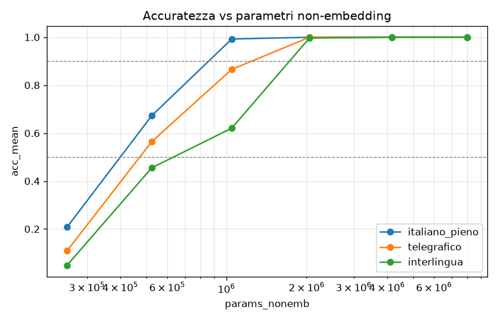
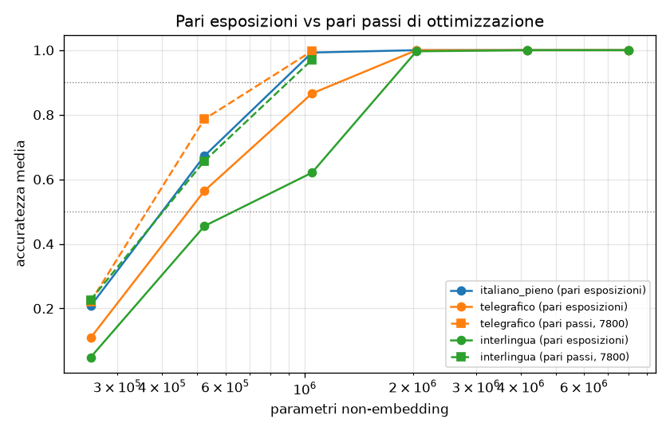
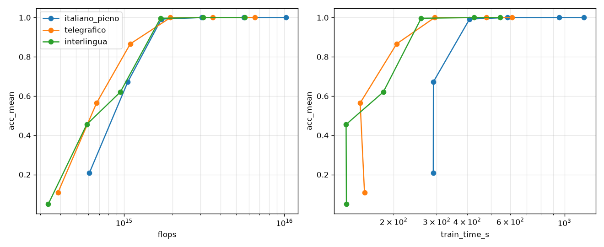

# La compressione linguistica riduce i parametri necessari?

**Esito in breve:** i dati supportano **H0**. Se i formati vengono confrontati a parità di passi di ottimizzazione, i parametri necessari per memorizzare gli stessi fatti sono quasi uguali nei tre formati: telegrafico circa −10%, interlingua circa +0/5% rispetto all'italiano pieno. A parità di esposizioni (il protocollo principale) i formati compressi ne richiedono addirittura **di più** (1,2–2×). La causa è che, con biografie più corte, fanno circa metà dei passi di ottimizzazione. Il vantaggio reale della compressione è nel **calcolo**: a pari passi, raggiungere il 90% costa circa il 57% dei FLOP e circa il 45% del tempo del pieno.

## Setup

| | |
|---|---|
| GPU | RTX 4070 SUPER 12 GB (non la 4060 indicata); picco VRAM 2,1–5,7 GB |
| Software | Python 3.11.9, PyTorch 2.6.0+cu124, bf16 autocast, SDPA, niente `torch.compile` |
| Dati | N = 20 000 persone inventate (nome+cognome unici), 6 attributi, seed dati 1234 |
| Tokenizer | BPE byte-level separato per formato, vocab 4096 |
| Modello | GPT decoder-only pre-LN, embedding legati, 6 taglie da 0,25M a 8M parametri non-embedding |
| Training | 200 esposizioni per biografia (template e ordine rigenerati a ogni epoca), AdamW (wd 0,01), warmup 2% + coseno, batch 256 sequenze × ctx 128, biografie intere impacchettate e separate da EOS |
| Valutazione | tutte le 20 000 persone × 6 attributi, prompt nativo, decodifica greedy, exact match |
| Seed | 2 seed di modello per ogni punto (0 e 1) |

Esempi di prompt: pieno `Marta Rinaldi è nata a` → `Bari`; telegrafico `Marta Rinaldi nata luogo` → `Bari`; interlingua `Marta Rinaldi NASC_L` → `Bari`. Ho verificato che ogni prompt di valutazione, quando compare nel testo di training, è seguito sempre dal valore giusto, cioè non è ambiguo.

### Calibrazione (pilota)
Con N=20 000 sul pieno: 0,25M → 21%, 8M → 100%. La transizione cade dentro lo sweep, quindi ho tenuto N=20 000 e le 200 esposizioni senza riduzioni. I due run del pilota hanno la configurazione identica al full e sono stati riusati come seed 0.

## Token medi per biografia

| formato | token/bio | vs pieno |
|---|---|---|
| italiano_pieno | 45,1 | 1,00 |
| telegrafico | 28,6 | 0,63 |
| interlingua | 24,6 | 0,55 |

## Risultati

### 1. Protocollo principale: pari esposizioni (200)

Accuratezza media (media su 2 seed):

| taglia (non-emb) | pieno | telegrafico | interlingua |
|---|---|---|---|
| 0,25M (253k) | 20,8% | 10,9% | 4,9% |
| 0,5M (525k) | 67,3% | 56,5% | 45,5% |
| 1M (1,05M) | 99,3% | 86,6% | 62,1% |
| 2M (2,05M) | 100% | 99,98% | 99,7% |
| 4M (4,18M) | 100% | 100% | 99,98% |
| 8M (7,99M) | 100% | 100% | 100% |

Parametri non-embedding necessari (interpolazione lineare in log-parametri):

| formato | 50% | rapporto vs pieno | 90% | rapporto vs pieno |
|---|---|---|---|---|
| italiano_pieno | 400k | 1,00 | 857k | 1,00 |
| telegrafico | 473k | **1,18** | 1,24M | **1,45** |
| interlingua | 632k | **1,58** | 1,72M | **2,01** |

### 2. Il fattore confondente: i passi di ottimizzazione
A pari esposizioni e con sequenze da 128 token, il pieno fa **7800 passi**, il telegrafico **4000** e l'interlingua **3600**. Le biografie compresse sono più corte e ogni sequenza ne contiene di più, quindi ogni passo copre più fatti e i passi totali diminuiscono. Lo svantaggio dei formati compressi visto sopra potrebbe venire da qui e non dal formato.

**Controllo aggiunto** (fuori dalla specifica originale, circa 30 min). Telegrafico e interlingua sono stati riaddestrati con batch ridotto (131 e 118 sequenze), così da avere esattamente **7800 passi** come il pieno. I dati, le esposizioni e le biografie per passo (~513) restano identici al pieno. Taglie 0,25M, 0,5M e 1M × 2 seed: è la zona della transizione, e sopra tutto è già al 100%.

| taglia | pieno (7800 passi) | telegrafico (7800) | interlingua (7800) |
|---|---|---|---|
| 0,25M | 20,8% | 22,1% | 22,7% |
| 0,5M | 67,3% | 78,7% | 65,7% |
| 1M | 99,3% | 99,7% | 97,0% |

| formato | params @50% | rapporto | params @90% | rapporto |
|---|---|---|---|---|
| italiano_pieno | 400k | 1,00 | 857k | 1,00 |
| telegrafico | 362k | **0,91** | 761k | **0,89** |
| interlingua | 402k | **1,01** | 896k | **1,05** |

Con lo stesso numero di aggiornamenti dei pesi le tre curve quasi si sovrappongono. Il divario del protocollo principale era dovuto quasi tutto ai passi di ottimizzazione, non alla capacità.

### 3. Calcolo e tempo

Somma su tutti i 36 run dello sweep (pari esposizioni):

| formato | token di training | FLOP | tempo GPU | vs pieno (token / FLOP / tempo) |
|---|---|---|---|---|
| italiano_pieno | 2,24 G | 4,45e16 | 2h04 | 1 / 1 / 1 |
| telegrafico | 1,43 G | 2,85e16 | 1h03 | 0,64 / 0,64 / 0,51 |
| interlingua | 1,24 G | 2,47e16 | 0h56 | 0,55 / 0,55 / 0,45 |

Calcolo necessario per *raggiungere* una soglia: FLOP ≈ 6 × parametri alla soglia × token di training per run, in rapporto al pieno.

| | telegrafico @50% | @90% | interlingua @50% | @90% |
|---|---|---|---|---|
| pari esposizioni | 0,76 | 0,93 | 0,88 | 1,11 |
| pari passi | 0,58 | **0,57** | 0,56 | **0,58** |

Tempo reale per il modello più piccolo che supera il 90%: pieno 1M → 409 s. Pari passi: telegrafico 1M → 194 s, interlingua 1M → 170 s (circa 0,45×). Pari esposizioni: telegrafico 2M → 294 s, interlingua 2M → 259 s.

Nota sul grafico del tempo: per le taglie piccole il tempo non scende con i parametri. Il run è limitato dall'overhead Python/kernel e non dalla GPU, e il primo run di ogni formato include anche la generazione della cache dei dati.

### 4. Per attributo
La **data di nascita** è il fatto più difficile in tutti i formati: a 0,5M e pari esposizioni è al 43% nel pieno, 9% nel telegrafico e 6% nell'interlingua, contro il 70–94% di città e azienda. È l'attributo con più entropia (~14,3 bit contro ~7 degli altri) e con più token. Seguono università e corso. Le tabelle complete sono in `results/summary.md`.

## Conclusione: H1 vs H0

- **H1 (molti meno parametri con testo compresso) è respinta.** In nessuna condizione i formati compressi richiedono "molti" meno parametri. Nel caso migliore (telegrafico a pari passi) il risparmio è di circa il 10%, dentro la variabilità tra seed vicino alla transizione (pieno 0,5M: 72% vs 62,5% tra i due seed). L'interlingua, il formato più compresso, non risparmia nulla.
- **H0 è supportata.** La capacità necessaria è guidata dai fatti da memorizzare, che sono gli stessi nei tre formati. Il "contorno" grammaticale dell'italiano pieno costa pochi parametri: le regolarità linguistiche (template, accordi, pronomi) si imparano una volta e servono per tutte le persone.
- **A pari esposizioni la compressione peggiora l'efficienza in parametri** (1,2–2×), perché comprime anche il numero di aggiornamenti dei pesi. Nel pieno il testo "superfluo" fa da riempitivo che moltiplica i passi per fatto.
- **Il beneficio reale è nel calcolo:** a parità di accuratezza e di passi, i formati compressi costano circa il 57% dei FLOP e circa il 45% del tempo, in linea con il rapporto dei token per biografia.

## Limiti

1. **Dati sintetici e semplici:** 6 attributi indipendenti, nessuna relazione tra fatti, nessun ragionamento. Il risultato riguarda la memorizzazione pura e non dice nulla sulla comprensione o sul linguaggio naturale reale.
2. **Il pieno non è davvero "naturale":** 4 template per attributo, senza articoli davanti ai valori (es. "ha studiato presso Università di Bologna") perché i valori dovevano restare identici in tutti i formati. Un italiano più ricco e vario potrebbe costare più capacità.
3. **Valori identici nei tre formati:** ho applicato alla lettera il requisito, quindi anche nell'interlingua la data è "12 marzo 1987" e i nomi hanno lo spazio (non `1987-03-12` né `Marta_Rinaldi` come nell'esempio). L'informazione è identica, ma l'interlingua è un po' meno compressa di quanto potrebbe.
4. **Frequenza del prompt esatto:** con più template il prompt canonico compare meno spesso nel training (pieno ~4% delle frasi per attributo, telegrafico ~8%, interlingua ~17%). Questo avvantaggia, se mai, i formati compressi, e quindi rafforza la conclusione H0.
5. **Risoluzione dello sweep:** la transizione cade tutta tra 0,25M e 1M. Le soglie sono interpolate su 3 punti e hanno un'incertezza stimabile in ±10–15%. Le taglie 2M–8M sono quasi tutte sature.
6. **Solo 2 seed**, un solo N (20 000), un solo numero di esposizioni (200), iperparametri (lr, wd) non ottimizzati separatamente per formato. Il controllo a pari passi copre solo le 3 taglie piccole.
7. **Tokenizer diversi:** ogni formato ha il suo BPE da 4096. I valori sono tokenizzati in modo simile ma non identico, e gli embedding (~0,3–1,2M parametri) sono esclusi dal conteggio non-embedding.

## Deviazioni dalla specifica
- GPU rilevata: RTX 4070 SUPER 12 GB invece di una 4060.
- Template corretto dopo il sanity check: "è nata il giorno {data}" rendeva ambiguo il prompt "è nata il". È stato sostituito prima del pilota e dello sweep.
- Aggiunto il controllo a pari passi (`control_steps.py`, `results/results_ctrl_steps.csv`).
- Tempo totale: training dello sweep 4h03, valutazione 9 min, controllo 30 min.

## File
- `results/results.csv`: 36 run dello sweep (`results_pilot.csv`, `results_quick.csv`, `results_sanity.csv`, `results_ctrl_steps.csv` per gli altri)
- `results/accuracy_vs_params.png`, `results/compute.png`, `results/accuracy_vs_params_equal_steps.png`, `results/summary.md`
- Codice: `src/` (config, data, model, pipeline, report), `run.py --quick|--pilot|--full|--report`, `control_steps.py`; test in `tests/`
- Checkpoint e log per run in `runs/`
