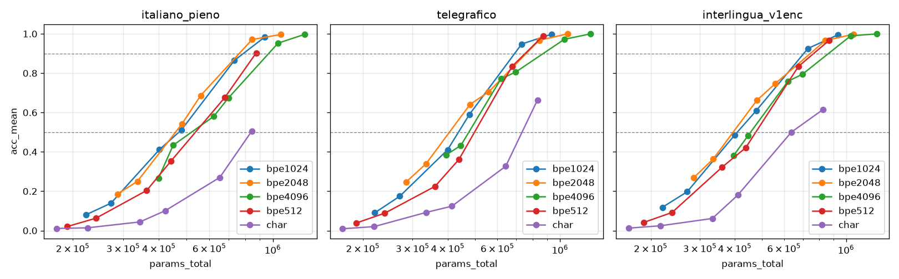

# Esperimento v3 — pipeline ottimizzata, vocabolario ridotto, traduzione a regole

> Stato: **completato** (Fasi 0, D, E). Piano confermato eseguito per intero: 2 seed per i BPE, seed 0
> per char, Fase E completa; **nessun taglio**. Latenze (D.6, E.4) e scomposizione dei tempi (D.5)
> rimisurate a GPU libera a fine piano. Conclusione in fondo, prima dei limiti.
> CSV in `results/v3/`. Codice nuovo in `src/v3/` (trainer `train3.py`, generatore `fastgen.py`),
> script di misura in `scripts/v3_*.py`.

## Fase 0 — ottimizzazione del codice

### 0.1 Profilo del training v2 (0,38M, E200, italiano_pieno)

`scripts/v3_profile.py` (torch.profiler, 300 step dopo 100 di warm-up) e
`scripts/v3_graph_probe.py` (step a forma fissa: eager, CUDA graph, torch.compile).

| Voce | Misura | Lettura |
|---|---|---|
| Step completo senza profiler | 16,1 ms | 512 biografie, ~27k token reali |
| Preparazione batch in Python (CPU) | 4–6 ms/step | loop su 512 biografie + padding numpy |
| `aten::nonzero` (indicizzazione booleana nella loss) | ~11 ms/step di CPU in attesa | **sincronizzazione CPU-GPU a ogni step**: la CPU aspetta il forward |
| Kernel GPU dominanti | matmul ~14%, log_softmax + backward ~12%, LayerNorm ~11% | kernel piccoli **limitati dalla banda di memoria**, non dai lanci |
| Stesso step catturato in CUDA graph | 24,3 ms contro 24,8 eager (loss su tutte le posizioni) | **nessun guadagno**: lo step non è limitato dai lanci di kernel |
| 2 / 3 / 4 processi in parallelo sulla GPU | ogni processo 2× / 3× / 4× più lento | **nessun guadagno aggregato**: la GPU è già satura |
| Valutazione v2 (30 000 domande) | 3,1–3,3 s per run | ~2% del tempo di un run; generazione senza KV cache |
| Generazione batch=1 (KV cache v2) | ~0,75 ms/token, uguale da 0,6M a 4M | qui sì: **limitata dai lanci di kernel** |

L'ipotesi di partenza ("GPU quasi vuota sui modelli piccoli") vale per la **generazione**, non per il
training. Nel training la GPU è occupata, ma da kernel poco efficienti: softmax su ~3800 voci di
vocabolario, LayerNorm, GELU e somme residue, ognuno letto e scritto in memoria separatamente.

### 0.2 Ottimizzazioni applicate e scartate

| Ottimizzazione | Esito | Motivo |
|---|---|---|
| `torch.compile` (triton-windows 3.2, installato in ~2 min) | **applicata** | fonde i kernel elementwise e la cross-entropy: step 1,3–1,4× più veloce (0,15M 12,9→9,2 ms, 0,38M 18,2→13,1, 0,79M 20,6→16,4); compilazione ~17 s a freddo, ~3 s con cache |
| Loss senza indicizzazione booleana (logits su tutte le posizioni, `ignore_index`) | **applicata** | elimina la sincronizzazione per step; necessaria anche per compile |
| Forma fissa (padding a ctx_len) | **applicata** | forme costanti, una sola compilazione; costo trascurabile (v2 riempiva già quasi fino al massimo) |
| Batch vettorizzati in numpy, memoria pinned + `non_blocking`, TF32, AdamW fused | **applicate** | la CPU prepara il batch successivo mentre la GPU lavora |
| `.item()` solo ogni 200 step; loss finali accumulate su GPU | **applicata** | nessuna sincronizzazione nel ciclo |
| Generazione con KV cache statica + CUDA graph per passo di decodifica | **applicata** | ~2× sulla latenza batch=1 |
| Dati pre-tokenizzati una volta per formato e riusati | già in v2 | cache `.npz` per epoca (tutte le augmentation), riusata tra taglie e seed; il caricamento non compare nel profilo, quindi niente memmap |
| Più run in parallelo sulla GPU | **scartata** | throughput aggregato invariato (misurato) |
| CUDA graph sul training | **scartata** | nessun guadagno (misurato) |
| Sequence packing | **non applicata** | guadagno massimo misurato 1,25× (step compilato senza padding: 13,1 → 10,5 ms). Serve una maschera di attenzione per biografia e posizioni azzerate per ognuna: implementazione più rischiosa per la riproducibilità dei risultati v2 |

### 0.3 Validazione: 3 configurazioni v2 rieseguite (seed 0)

| Config | acc v2 | acc v3 | Δ | loss finale v2 → v3 |
|---|---|---|---|---|
| italiano_pieno 0,38M | 0,673 | 0,671 | −0,003 | 0,799 → 0,792 |
| italiano_pieno 0,60M | 0,924 | 0,944 | **+0,020** | 0,616 → 0,607 |
| telegrafico 0,38M | 0,801 | 0,787 | −0,014 | 0,849 → 0,876 |

- **Due configurazioni su tre** sono entro ±0,02.
- **Pieno 0,60M** è a +0,0204, appena oltre la tolleranza. Questa taglia è nel punto più ripido della
  curva: in v2 i due seed della stessa configurazione differivano di 0,06 (0,924 contro 0,982).
  Considero la differenza rumore numerico, non un cambio di comportamento.
- **Perché i risultati non sono identici bit per bit:** la cross-entropy ora è calcolata in float32
  (in v2 in bf16) e i kernel fusi cambiano l'ordine delle somme. L'ordine dei dati e tutti gli
  iperparametri sono identici a v2, verificato dai test (`tests/v3/`).

### 0.4 Speedup prima / dopo

| Misura | v2 | v3 | Speedup |
|---|---|---|---|
| Step di training 0,38M (forma fissa) | 18,2 ms | 13,1 ms | 1,39× |
| Run completo pieno 0,38M (training) | 170 s | 110 s | **1,55×** |
| Run completo pieno 0,60M | 174 s | 116 s | **1,50×** |
| Run completo telegrafico 0,38M | 130 s | 86 s | **1,51×** |
| Throughput a regime (token/s), stessi 3 run | 1,09–1,22M | 1,93–2,31M | 1,6–2,1× |
| Valutazione per run (30 000 domande) | 3,1–3,3 s | 2,0–2,6 s | 1,3–1,5× |
| Latenza di generazione batch=1 (6 token di prompt, 4 nuovi) | 3,0–3,4 ms | 1,5–1,6 ms | **2,1–2,2×** |
| Latenza batch=64 (0,60M / 1,49M / 4M) | 3,2 / 3,7 / 3,5 ms | 1,8 / 2,0 / 3,5 ms | 1,8× / 1,8× / 1,0× |
| **Sweep complessivo** (run in sequenza) | — | — | **~1,5×** (es. A_main v2: 3,5 h → ~2,3 h) |

Nel tempo di un run v3 sono inclusi ~3–17 s di compilazione e ~10 s di avvio. Il throughput a regime
li esclude, per questo è più alto. Lo sweep accelera quanto il singolo run, perché i run in parallelo
non aiutano. File: `results/v3/phase0_validation.csv`, `results/v3/phase0_generation.csv`.

**Effetto sulle misure di latenza.** Il nuovo generatore cambia i tempi assoluti di risposta. Nelle
Fasi D ed E tutti i formati, compreso il pieno di riferimento, sono misurati con lo stesso generatore,
quindi i confronti restano omogenei. I valori assoluti non sono confrontabili con la Fase C v2 (~2×
più bassi).

## Fase D — sweep del vocabolario

Protocollo: 3 formati (italiano_pieno, telegrafico, interlingua_v1enc), 6 taglie 0,15M–0,79M
non-embedding, pari passi (512 bio/step), E200, 2 seed, lr di v2 per taglia, ctx adattato alla bio
più lunga. Il BPE 4096 è quello di v2 (A_main / A_abl, stessi modelli). Il BPE ha sempre le cifre
singole. Le soglie sono interpolate log-lineari sulla media dei seed.

### D.1 Token per biografia

| vocab | pieno | telegrafico | interlingua_v1enc |
|---|---|---|---|
| char (alfabeto) | 230,7 (72) | 170,4 (70) | 137,8 (70) |
| BPE 512 | 83,6 | 63,4 | 57,6 |
| BPE 1024 | 66,6 | 49,6 | 45,5 |
| BPE 2048 | 57,5 | 40,8 | 36,9 |
| BPE 4096 (v2) | 50,8 | 34,3 | 30,3 |

Il rapporto token telegrafico/pieno resta quasi costante (0,74–0,76 con i BPE), quindi il vocabolario
più piccolo non cambia il vantaggio di lunghezza del formato compresso.

### D.2 Verifica del learning rate (0,38M, seed 0, BPE 512)

| formato | lr 1× | lr 2× (v2) | lr 4× |
|---|---|---|---|
| pieno | 0,278 | **0,353** | 0,300 |
| telegrafico | 0,313 | 0,362 | **0,376** |
| interlingua_v1enc | 0,359 | **0,449** | 0,418 |

Il lr di v2 resta il migliore per pieno e interlingua. Per il telegrafico vince 4× di poco
(+0,014), quindi le sue taglie BPE 512 usano lr ×2 rispetto a v2. BPE 1024 usa il lr di v2 senza
verifica, come previsto dal piano.

### D.3 Accuratezza media per taglia (media di 2 seed)

| taglia non-emb | vocab | pieno | telegrafico | interlingua_v1enc |
|---|---|---|---|---|
| 0,15M | 4096 / 2048 / 1024 / 512 | .266 / .186 / .080 / .020 | .385 / .247 / .090 / .038 | .382 / .268 / .118 / .041 |
| 0,20M | 4096 / 2048 / 1024 / 512 | .434 / .250 / .139 / .063 | .432 / .339 / .175 / .089 | .484 / .363 / .197 / .092 |
| 0,31M | 4096 / 2048 / 1024 / 512 | .581 / .543 / .411 / .204 | .771 / .642 / .411 / .225 | .759 / .662 / .484 / .321 |
| 0,38M | 4096 / 2048 / 1024 / 512 | .674 / .687 / .511 / .353 | .805 / .704 / .590 / .362 | .794 / .746 / .609 / .421 |
| 0,60M | 4096 / 2048 / 1024 / 512 | .953 / .971 / .865 / .676 | .972 / .968 / .948 / .835 | .990 / .966 / .926 / .834 |
| 0,79M | 4096 / 2048 / 1024 / 512 | .997 / .997 / .984 / .903 | 1,00 / 1,00 / .998 / .990 | 1,00 / .998 / .994 / .967 |

A pari parametri **non-embedding** il vocabolario piccolo è quasi sempre peggio: il modello deve
comporre i valori da più token. Con BPE 4096 l'embedding però pesa molto: 0,31M per pieno a 0,38M,
cioè il 44% del totale. In parametri **totali** il quadro si inverte (D.4). La deviazione standard
fra seed arriva a 0,076 (telegrafico 1024, 0,38M) e a 0,047 (telegrafico 2048, 0,60M): differenze di
soglia sotto il 5% sono nel rumore.

### D.4 Soglie in parametri totali (embedding + posizioni + corpo)

Token per biografia per vocabolario: `results/v3/tok_bio_vs_vocab.png`; pipeline E.4:
`results/v3/pipeline_compare.png`.

| formato | vocab | 50% totali | 90% totali | 90% non-emb | 50% vs pieno stesso vocab | 90% vs pieno stesso vocab |
|---|---|---|---|---|---|---|
| pieno | 4096 | 520k | 967k | 559k | 1 | 1 |
| pieno | **2048** | **457k** | **763k** | 544k | 1 | 1 |
| pieno | 1024 | 470k | 789k | 658k | 1 | 1 |
| pieno | 512 | 537k | 872k | 790k | 1 | 1 |
| pieno | char | 839k | — | — | 1 | — |
| telegrafico | 4096 | 475k | 872k | 502k | 0,91 | 0,90 |
| telegrafico | 2048 | **405k** | 759k | 543k | 0,89 | 0,99 |
| telegrafico | 1024 | 436k | **690k** | 573k | 0,93 | 0,875 |
| telegrafico | 512 | 498k | 753k | 680k | 0,93 | 0,86 |
| telegrafico | char | 733k | — | — | 0,87 | — |
| interlingua_v1enc | 4096 | 455k | 866k | 496k | 0,88 | 0,89 |
| interlingua_v1enc | 2048 | **394k** | 745k | 532k | 0,86 | 0,98 |
| interlingua_v1enc | 1024 | 408k | **706k** | 587k | 0,87 | 0,89 |
| interlingua_v1enc | 512 | 475k | 766k | 694k | 0,89 | 0,88 |
| interlingua_v1enc | char | 637k | — | — | 0,76 | — |

Il "—" del char indica che il 90% non è raggiunto entro 0,79M non-emb (D.4bis).

1. **Vocabolario ottimo: BPE 2048 al 50% per tutti e tre i formati; al 90% BPE 2048 per il pieno e
   BPE 1024 per telegrafico e interlingua.** Fra 1024 e 2048 la differenza è del 3–10% e la soglia al
   90% cade fra le taglie 0,38M e 0,60M, dove la griglia è rada: i due vocabolari sono di fatto
   alla pari. Rispetto al 4096 di v2 il vocabolario ottimo riduce i parametri totali al 90% del 21%
   (pieno), 21% (telegrafico) e 18% (interlingua). 512 e char sono peggio: il risparmio
   sull'embedding non compensa il corpo più grande che serve.
2. **Il formato compresso non guadagna dal vocabolario piccolo più del pieno.** Il rapporto
   compresso/pieno a pari vocabolario oscilla fra 0,86 e 0,93 per tutti i BPE (con due eccezioni a
   0,98–0,99, telegrafico e interlingua 2048 al 90%, dovute a un seed debole a 0,60M). Senza una
   tendenza con la taglia del vocabolario. Solo il char favorisce il compresso (0,76–0,87 al 50%), su
   un vocabolario che resta il peggiore in assoluto.
3. **Il miglior compresso contro il miglior pieno** (ognuno col suo vocabolario ottimo):

   | livello | pieno ottimo | telegrafico ottimo | rapporto | interlingua ottimo | rapporto |
   |---|---|---|---|---|---|
   | 50% | 457k (2048) | 405k (2048) | **0,89** | 394k (2048) | **0,86** |
   | 90% | 763k (2048) | 690k (1024) | **0,90** | 706k (1024) | **0,93** |

   Sono gli stessi rapporti di v2 con BPE 4096 (0,88–0,91). Ottimizzare il vocabolario abbassa i
   parametri di tutti del 12–21%, ma il vantaggio del formato compresso resta ~10%.

### D.4bis Vocabolario a caratteri (seed 0)

Verifica lr a 0,38M:

| formato | lr 1× | lr 2× (v2) | lr 4× |
|---|---|---|---|
| pieno | 0,038 | 0,097 | **0,101** |
| telegrafico | 0,070 | 0,115 | **0,124** |
| interlingua_v1enc | 0,087 | 0,143 | **0,181** |

Il 4× vince per tutti, quindi tutte le taglie char usano lr ×2 rispetto a v2. Il massimo cade sul bordo
della griglia: un lr ancora più alto potrebbe aiutare (vedi limiti).

| taglia non-emb | pieno | telegrafico | interlingua_v1enc |
|---|---|---|---|
| 0,15M | .011 | .009 | .012 |
| 0,20M | .014 | .020 | .024 |
| 0,31M | .044 | .093 | .061 |
| 0,38M | .101 | .124 | .181 |
| 0,60M | .270 | .327 | .500 |
| 0,79M | .505 | .664 | .615 |

**A caratteri nessun formato arriva al 90% entro 0,79M.** Soglie al 50% in parametri totali:

| formato | 50% char | 50% BPE 1024 |
|---|---|---|
| pieno | 839k | 470k |
| telegrafico | 733k (0,87× pieno char) | 436k |
| interlingua_v1enc | 637k (0,76× pieno char) | 408k |

L'embedding a caratteri è minuscolo (72 simboli). Il modello però deve ricomporre ogni valore lettera per
lettera, su sequenze 3–5 volte più lunghe, e gli servono ~1,8× i parametri totali del BPE 1024. Il run
costa anche 3–5× di più: 609 s per pieno a 0,79M, contro ~100 s col BPE. Qui il formato compresso
guadagna di più che nei BPE (0,76–0,87× al 50%), perché accorciare la sequenza pesa di più quando
ogni carattere è un token. Ma è un guadagno su un vocabolario che nessuno sceglierebbe.

### D.5 Tempo di training

Per run, a pari passi, i vocabolari piccoli **non sono più veloci** del 4096. Per il pieno, in media
sulle 6 taglie: 115 s (512), 101 s (1024), 96 s (2048), contro ~110 s del 4096 a 0,38M (validazione
0.3). La softmax più piccola fa risparmiare, ma le sequenze più lunghe (+65%, +31%, +13% di token
rispetto al 4096) costano di più nel corpo del modello.

Tempo di training fino al 90%, interpolato in parametri totali. I tempi del BPE 4096 vengono dai run
v2 e sono riportati al codice v3 con il fattore della validazione 0.3 (×0,65):

| formato | 4096 (v3 equiv.) | 2048 | 1024 | 512 |
|---|---|---|---|---|
| pieno | ~113 s | 118 s | 135 s | 172 s |
| telegrafico | ~85 s | 78 s | 104 s | 131 s |
| interlingua_v1enc | ~80 s | 73 s | 100 s | 119 s |

**Il tempo di training al 90% è minimo con BPE 2048–4096.** Con 1024 e 512 il modello è più piccolo
in parametri totali, ma ha un corpo più grande e lavora su sequenze più lunghe: +20–25% di tempo con
1024, +50% con 512. In tempo il formato compresso è in vantaggio a ogni vocabolario: telegrafico
0,66–0,77× il pieno, interlingua 0,62–0,74×.

**Scomposizione del tempo per step** (`scripts/v3_timing.py`, 0,38M, batch 512, forward+backward
compilati, mediana di 3 ripetizioni a GPU libera; la prima misura rumorosa è in
`D_timing_v0_noisy.csv`).
- **Testa:** proiezione sul vocabolario + softmax + cross-entropy, a parità di token (27 136) e con i
  token reali.
- **Corpo:** embedding + blocchi + LayerNorm finale, con la lunghezza reale T.

| formato | vocab | T | testa a pari token | testa reale | corpo | step stimato | risparmio softmax vs 4096 | perdita da sequenze più lunghe |
|---|---|---|---|---|---|---|---|---|
| pieno | 4096 | 64 | 11,0 | 10,7 | 7,8 | 18,6 | — | — |
| pieno | 2048 | 78 | 1,9 | 2,1 | 11,3 | 13,4 | 9,1 | 4,0 |
| pieno | 1024 | 93 | 1,5 | 1,4 | 12,5 | 13,9 | 9,5 | 4,8 |
| pieno | 512 | 120 | 0,9 | 1,6 | 14,8 | 16,4 | 10,1 | 7,9 |
| pieno | char | 303 | 1,0 | 0,9 | 53,1 | 54,0 | 9,9 | 45,4 |
| telegrafico | 4096 | 44 | 11,1 | 7,4 | 6,7 | 14,1 | — | — |
| telegrafico | 2048 | 56 | 1,7 | 4,8 | 8,9 | 13,7 | 9,5 | 9,1 |
| telegrafico | 1024 | 74 | 0,8 | 3,3 | 10,9 | 14,2 | 10,3 | 10,5 |
| telegrafico | 512 | 98 | 0,5 | 2,5 | 13,2 | 15,7 | 10,7 | 12,3 |
| telegrafico | char | 225 | 0,8 | 2,6 | 37,3 | 39,9 | 10,4 | 36,2 |
| interlingua_v1enc | 4096 | 40 | 11,2 | 6,6 | 6,3 | 12,8 | — | — |
| interlingua_v1enc | 2048 | 52 | 1,6 | 4,4 | 7,7 | 12,0 | 9,5 | 8,7 |
| interlingua_v1enc | 1024 | 70 | 0,8 | 3,0 | 11,4 | 14,4 | 10,4 | 12,0 |
| interlingua_v1enc | 512 | 88 | 0,4 | 2,3 | 13,9 | 16,2 | 10,7 | 14,1 |
| interlingua_v1enc | char | 189 | 0,5 | 1,7 | 36,3 | 38,0 | 10,6 | 35,8 |

Tempi in ms. "Risparmio softmax" = testa del 4096 meno testa del vocabolario, a pari token. "Perdita
da sequenze più lunghe" = corpo più lungo + token in più nella testa, rispetto al 4096.

1. **La testa del 4096 costa ~11 ms, quella del 2048 ~1,7 ms: un salto di 6× per un vocabolario 2×.**
   Il V reale del BPE "4096" è 3 781–3 814, non multiplo di 64. Questo probabilmente impedisce i
   kernel matmul/softmax più efficienti: un 4096 allineato (o un padding a 3 840) costerebbe meno.
   Il risparmio sulla softmax (~9–11 ms) è quindi in parte un effetto di allineamento.
2. **Per il pieno il risparmio vince:** lo step scende da 18,6 a 13,4 ms (2048) e 13,9 ms (1024).
   **Per i formati compressi è quasi in pari:** le loro sequenze sono corte e la testa del 4096 pesa
   meno sul totale (14,1 → 13,7–14,2 ms per il telegrafico).
3. **512 e char perdono:** la sequenza più lunga costa più di quanto risparmia la softmax (char 2,8–3×
   lo step del 4096).

Nota: la testa "reale" dei formati compressi costa più di quella a pari token pur avendo meno token
(es. telegrafico 2048: 4,8 contro 1,7 ms). Anche qui il numero di token non è allineato. Queste
micro-misure sono sensibili alle forme dei tensori: i tempi per run di D.5 sono il riferimento.

### D.6 Latenza di risposta (core, lunghezza oracolo)

Misura con `vocab.latency`: StaticGen bf16 con CUDA graph, 1000 domande "in". Ogni lotto genera
esattamente i token della risposta vera. Lotti senza padding, raggruppati per (lunghezza del prompt,
lunghezza della risposta). Rimisurata a GPU libera dopo la correzione del warm-up; la prima misura
difettosa è in `D_latency_v0_warmup_bug.csv`. Media delle taglie 0,60M e 0,79M, seed 0.

| vocab | token risposta | b=1 pieno | b=1 tele | b=1 inter | b=64 risposte/s pieno | tele | inter | riempimento lotti (pieno) |
|---|---|---|---|---|---|---|---|---|
| 4096 | 3,1 | 1,67 ms | 1,74 ms | 1,75 ms | 15 300 | 17 800 | 17 200 | 40 / 64 |
| 2048 | 3,6 | 2,00 ms | 2,03 ms | 1,98 ms | 5 400 | 6 100 | 4 100 | 18 / 64 |
| 1024 | 5,0 | 2,49 ms | 2,43 ms | 2,44 ms | 3 100 | 4 200 | 3 900 | 12 / 64 |
| 512 | 6,7–7,5 | 3,19 ms | 2,96 ms | 2,79 ms | 2 000 | 2 100 | 2 200 | 8 / 64 |
| char | 15,8 | 5,97 ms | 5,45 ms | 5,24 ms | 380 | 480 | 500 | 3 / 64 |

1. **Con batch=1 la latenza dipende dal vocabolario, non dal formato.** La risposta è il valore,
   uguale in tutti i formati, quindi i token generati sono gli stessi. Il prompt più corto del
   compresso si legge in un solo passo di prefill e pesa poco. Con 1024–4096 i tre formati
   stanno entro ±5% a pari vocabolario; con 512 e char il compresso è fino al 13% più veloce. Anche la taglia conta poco: a queste dimensioni ogni passo è
   limitato dai lanci dei kernel, 0,4–0,6 ms per token da 0,15M a 0,79M.
2. **Il vocabolario piccolo rallenta la risposta**, perché servono più token per lo stesso valore:
   +15–20% (2048), +40–50% (1024), +60–90% (512) e 3–3,6× (char) rispetto al 4096.
3. **Con batch=64 il 4096 fa 3–4× più risposte al secondo.** Il motivo è soprattutto che i suoi lotti
   sono più pieni: con prompt e risposte più corti ci sono meno combinazioni di lunghezza. Il costo
   per lotto è simile (2,5 ms contro 3–4 ms). Il telegrafico fa più risposte al secondo del pieno con
   ogni BPE (+7–35%) per la stessa ragione: prompt più corti e più uniformi. L'interlingua varia da
   −24% a +26%. È un effetto del
   raggruppamento senza padding più che del calcolo.
4. **Combinando con D.4:** il vocabolario che minimizza i parametri del telegrafico (1024) ha una
   latenza a batch=1 del 22% più alta del pieno col suo vocabolario ottimo (2048): 2,43 contro
   2,00 ms. Con lo stesso vocabolario (2048) il telegrafico è alla pari col pieno (2,03 contro
   2,00 ms) e ha l'11% di parametri in meno al 50%.

## Fase E — traduzione a regole

Eseguita prima della Fase D, come concordato. I formati nuovi usano quindi il **BPE 4096 con cifre
singole**, il migliore noto da v2: il vocabolario "migliore della Fase D" non era ancora disponibile.
Pari passi, E200, lr di v2 del telegrafico per taglia.

### E.1 Gli stripper

- **spaCy** (`it_core_news_sm`, `src/v3/strip.py`): toglie le parole con POS DET (articoli), AUX
  (ausiliari e copula), ADP (preposizioni, anche dentro i valori: "Università di Brescia" →
  "Università Brescia") e PRON con funzione di soggetto.
- **Lista**: toglie le parole di un elenco fisso (`STRIP_WORDS` in `src/v3/spec3.py`): articoli,
  forme di essere/avere, pronomi soggetto, preposizioni semplici e articolate. Nessun POS tagging.
- **Applicazione:** entrambi applicati frase per frase al corpus pieno pre-generato (201 epoche, con le
  augmentation). Le frasi distinte (~1,4M) sono passate una volta sola. Costruzione: spaCy 269 s (12
  processi), lista 77 s.

Esempio (stessa biografia):

| Formato | Testo |
|---|---|
| pieno | Laura Madau è originaria di Sondrio. Lei si è laureata in Ingegneria civile. Lei è impiegata presso Cucine Lube. È nata il 24 maggio 1984. Lavora come radiologo. Lei ha fatto gli studi presso Università di Brescia. |
| spaCy | Laura Madau originaria Sondrio. si laureata Ingegneria civile. impiegata Cucine Lube. nata 24 maggio 1984. Lavora radiologo. fatto studi Università Brescia. |
| lista | Laura Madau originaria Sondrio. si laureata Ingegneria civile. impiegata Cucine Lube. nata 24 maggio 1984. Lavora come radiologo. fatto studi Università Brescia. |

**Confronto su 200 biografie** (`results/v3/E_strip_compare.csv`):

| | pieno | spaCy | lista |
|---|---|---|---|
| parole per biografia | 38,9 | 22,4 | 22,0 |
| token BPE per biografia (tokenizer del formato) | 50,7 | 34,2 | 33,7 |
| token per biografia sull'intero corpus | 50,8 | 34,3 | 33,8 |

- **Le due versioni differiscono nell'82% delle biografie,** sempre per poche parole.
- **Solo la lista toglie "ha"** (193 volte su 200 biografie): spaCy lo tagga VERB in "ha il ruolo",
  "ha i natali", "ha come data di nascita".
- **Solo spaCy toglie "come"** (103 volte, tagger ADP in "lavora come") e "dell'" (4).
- **Errore del tagger:** spaCy elimina il nome di battesimo nello 0,4% delle domande (82 su 20 000:
  Vanessa, Quinto, Nives, Margherita…), perché li tagga come parole funzionali. Quei casi restano nel
  corpus e nella valutazione: è un difetto reale dello strumento.
- **Lunghezza:** entrambi gli stripper producono testi lunghi come il telegrafico a template (34,3
  token per biografia).

**Domande ambigue dopo lo stripping.** Con il template di domanda standard (template 0) entrambi gli
stripper rendono identiche due coppie di domande:
- "è nato il" (data) e "è nato a" (luogo) diventano entrambe "nato";
- "lavora come" (professione) e "lavora per" (azienda) diventano entrambe "lavora".

Per ogni attributo le domande della Fase E usano quindi il primo template che resta univoco dopo lo
stripping (`E_QUESTION_TEMPLATE`): "ha come data di nascita il", "è originario di", "ha studiato
presso", "si è laureato in", "esercita la professione di", "ha lavorato presso". Il pieno di
riferimento risponde alle stesse domande. Nel corpus di training le frasi ambigue restano: lì il valore
stesso (data o città) disambigua.

### E.2 telegrafico_auto vs telegrafico a template

| Taglia | italiano_pieno | telegrafico (template, v2) | **telegrafico_auto** (spaCy) | telegrafico_lista |
|---|---|---|---|---|
| 0,15M | 0,266 | 0,385 | 0,280 | – |
| 0,20M | 0,434 | 0,432 | 0,374 | – |
| 0,31M | 0,581 | 0,771 | 0,585 | – |
| 0,38M | 0,674 | 0,805 | 0,669 | – |
| 0,60M | 0,953 | 0,972 | 0,937 | 0,976 (s0) |
| 0,79M | 0,997 | 1,000 | 0,995 | – |
| 1,49M | 1,000 | 1,000 | 0,998 (s0) | 0,996 (s0) |
| 4M | 1,000 | 1,000 | 0,998 (s0) | 0,996 (s0) |

| Formato | 50% non-emb | 90% non-emb | rapporto vs pieno 50% / 90% (s0 / s1) | rapporto vs template 50% / 90% |
|---|---|---|---|---|
| italiano_pieno | 244k | 559k | 1 / 1 | – |
| telegrafico (template) | 219k | 501k | 0,89 / 0,90 | 1 / 1 |
| **telegrafico_auto** | 261k | 572k | **1,07 / 1,02** (1,11/1,02 e 1,01/1,03) | **1,19 / 1,14** |

In parametri totali: 1,06× / 1,03× il pieno.

- **Lo stripping automatico non riduce i parametri.** telegrafico_auto ha la stessa lunghezza del
  telegrafico a template (34,3 token per biografia), ma ha bisogno di più parametri del pieno al 50% e
  di altrettanti al 90%.
- **Il vantaggio del telegrafico a template in v2 veniva quindi dalla regolarità del testo, non dal
  minor numero di token.** Il template ha 2 forme fisse per attributo e nessun pronome. Lo stripper
  conserva invece le 4 varianti del pieno, i pronomi impliciti e le maiuscole di inizio frase, quindi
  la stessa varietà da memorizzare con meno parole.
- **Attributi più lenti:** professione e data di nascita, che telegrafico_auto impara per ultimi (a
  0,38M: 0,20 e 0,07).
- **telegrafico_lista**, misurato solo per la pipeline (3 taglie, seed 0): a 0,60M 0,976, sopra il
  pieno (0,953, media di 2 seed) e telegrafico_auto (0,937). Con un solo seed, alla taglia di
  transizione, non basta per una soglia.

### E.3 Realizzatore a regole

`src/v3/realize.py`:
- **Telegrafico:** dalla domanda compressa riconosce attributo e nome (il genere è dedotto dal nome di
  battesimo). Mappa il valore generato sul valore canonico con una tabella "valore strippato → valore
  canonico" (fallback: massima sovrapposizione di parole). Ricostruisce la frase piena con il template
  e l'accordo di genere.
- **Interlingua:** convertitore a regole della domanda piena ("Nome ha studiato presso" →
  "Nome_Cognome UNI"). Dal valore generato (date ISO, underscore) ricostruisce la frase piena.
- Sul dataset sintetico il realizzatore è **esatto per costruzione**: test di andata e ritorno ≥99% con
  entrambi gli stripper, 100% sull'interlingua. L'accuratezza end-to-end è quindi un **limite
  superiore** rispetto a un testo reale.

### E.4 Pipeline end-to-end a regole vs core pieno

Stesse 1000 domande per tutti i formati, generatore v3 (KV cache statica + CUDA graph, con tutti i
grafi catturati prima della misura). Tempi in ms per richiesta (b=1) o per lotto di 64 (b=64).
- **Stripper e realizzatore:** tempo CPU.
- **Core:** tokenizzazione + generazione sincronizzata (GPU).
- **Fine della risposta:** al token "." per pieno e telegrafici; per l'interlingua, senza punto finale,
  lunghezza oracolo come nella Fase C.

La prima misura, con le catture dei CUDA graph dentro il tempo (~60 ms per lotto a b=64), è in
`E_pipeline_v0_warmup_bug.csv`. A b=1 cambiava poco; a b=64 nascondeva il costo di spaCy.

| Formato | Taglia | b | stripper CPU | core GPU | realizzatore CPU | **totale** | core pieno | **totale / pieno** | FLOP core / pieno | acc core | acc end-to-end | acc pieno |
|---|---|---|---|---|---|---|---|---|---|---|---|---|
| tele_lista | 0,60M | 1 | 0,011 | 3,23 | 0,028 | **3,27** | 3,28 | **1,00×** | 0,82× | 0,978 | 0,980 | 0,933 |
| tele_lista | 1,49M | 1 | 0,011 | 3,27 | 0,023 | **3,31** | 3,43 | **0,97×** | 0,82× | 0,998 | 1,000 | 1,000 |
| tele_lista | 4M | 1 | 0,011 | 3,38 | 0,023 | **3,41** | 3,54 | **0,96×** | 0,82× | 0,998 | 1,000 | 1,000 |
| tele_lista | 0,60M | 64 | 0,23 | 5,52 | 0,88 | **6,62** | 7,01 | **0,95×** | 0,85× |  |  |  |
| tele_lista | 1,49M | 64 | 0,23 | 6,79 | 0,60 | **7,62** | 6,61 | **1,15×** | 0,78× |  |  |  |
| tele_lista | 4M | 64 | 0,25 | 8,41 | 0,64 | **9,30** | 10,98 | **0,85×** | 0,78× |  |  |  |
| tele_auto (spaCy) | 0,60M | 1 | 1,35 | 3,77 | 0,035 | **5,15** | 3,55 | **1,45×** | 0,83× | 0,921 | 0,921 | 0,933 |
| tele_auto (spaCy) | 1,49M | 1 | 1,33 | 3,70 | 0,025 | **5,06** | 3,50 | **1,45×** | 0,82× | 0,996 | 0,997 | 1,000 |
| tele_auto (spaCy) | 4M | 1 | 1,34 | 3,97 | 0,025 | **5,34** | 3,64 | **1,47×** | 0,82× | 0,996 | 0,997 | 1,000 |
| tele_auto (spaCy) | 0,60M | 64 | 69,87 | 8,48 | 1,29 | **79,64** | 6,27 | **12,71×** | 0,94× |  |  |  |
| tele_auto (spaCy) | 1,49M | 64 | 70,17 | 8,71 | 0,63 | **79,51** | 9,01 | **8,83×** | 0,86× |  |  |  |
| tele_auto (spaCy) | 4M | 64 | 69,59 | 10,33 | 0,61 | **80,53** | 12,03 | **6,69×** | 0,86× |  |  |  |
| interlingua (regole) | 0,60M | 1 | 0,004 | 2,26 | 0,032 | **2,29** | 3,35 | **0,68×** | 0,91× | 0,935 | 0,935 | 0,933 |
| interlingua (regole) | 1,49M | 1 | 0,004 | 2,40 | 0,014 | **2,41** | 3,30 | **0,73×** | 0,91× | 1,000 | 1,000 | 1,000 |
| interlingua (regole) | 4M | 1 | 0,004 | 2,44 | 0,013 | **2,46** | 3,64 | **0,68×** | 0,91× | 1,000 | 1,000 | 1,000 |
| interlingua (regole) | 0,60M | 64 | 0,085 | 6,95 | 0,19 | **7,23** | 7,28 | **0,99×** | 1,22× |  |  |  |
| interlingua (regole) | 1,49M | 64 | 0,086 | 6,49 | 0,19 | **6,77** | 9,24 | **0,73×** | 1,22× |  |  |  |
| interlingua (regole) | 4M | 64 | 0,086 | 7,20 | 0,19 | **7,48** | 8,36 | **0,90×** | 1,21× |  |  |  |

Con batch=64 le accuratezze sono identiche a batch=1 (stesse risposte greedy). I tempi a b=64 del
core sono di pochi ms per lotto e oscillano del ±30% fra taglie (pieno 6,3–12,0 ms, senza
andamento con la taglia): i rapporti a b=64 vanno letti come medie.

**Confronto con la pipeline neurale della Fase C** (stripper e traduttore da ~1M, generatore v2):

| Pipeline | totale / core pieno, b=1 | b=64 |
|---|---|---|
| neurale (Fase C) | 6,1–7,4× | 3,3–4,6× |
| spaCy + realizzatore a regole | 1,45–1,47× | 6,7–12,7× |
| **lista + realizzatore a regole** | **0,96–1,00×** | **0,85–1,15× (media 0,98×)** |
| interlingua a regole (lunghezza oracolo) | 0,68–0,73× | 0,73–0,99× |

**Lettura.**
1. **Le regole eliminano il costo della traduzione.** Lo stripper a lista costa 0,011 ms per domanda e
   il realizzatore 0,02–0,03 ms, ~1% del tempo totale (a b=64: 0,23 + 0,6–0,9 ms per lotto). La
   pipeline lista costa quindi quanto il core pieno da solo: **non più lenta, ma nemmeno più veloce**
   (0,96–1,00× a b=1). La risposta è il valore, con la stessa forma nei due formati: il core compresso
   non ha niente da risparmiare in decodifica. La domanda più corta riduce i FLOP del 15–22%, ma il
   risparmio non si vede in latenza, perché a queste taglie ogni passo è limitato dai lanci dei kernel.
2. **spaCy è troppo lento per questo uso:** 1,35 ms per domanda (tagger + parser), un quarto della
   latenza a b=1 (1,45×). A b=64 domina: 70 ms per 64 domande (`nlp.pipe` senza multiprocessing) contro
   6–12 ms di core, quindi 7–13× il pieno, peggio della pipeline neurale della Fase C.
3. **Il vantaggio dell'interlingua (0,68–0,73× a b=1) viene dalla regola di stop, non dal formato.**
   Interlingua usa la lunghezza oracolo, quindi genera esattamente i token del valore. Il pieno invece
   deve generare il "." e il generatore controlla la fine ogni 4 passi. A parità di regola (lunghezza
   oracolo per tutti, D.6) interlingua_v1enc e pieno hanno la stessa latenza con BPE 4096 (1,75 contro
   1,67 ms a b=1). Con batch=64 l'interlingua costa anche più FLOP (1,22×): risposte più lunghe (date
   ISO a cifre singole).
4. **Nessuna perdita di accuratezza.** Le pipeline a regole hanno la stessa accuratezza del core; a
   0,60M la lista è sopra il pieno (0,980 contro 0,933). Unica eccezione telegrafico_auto a 0,60M
   (0,921), con il nome perso dal tagger e la taglia di transizione.

## Conclusione

**Domanda: con vocabolario e traduzione ottimizzati, la compressione riduce i parametri totali e la
latenza di risposta, sì o no, e di quanto?**

| | risposta | di quanto |
|---|---|---|
| **parametri totali** | **sì, poco** | **~10%**: miglior compresso / miglior pieno = 0,86–0,93× (D.4) |
| **latenza di risposta** | **no** | 0,96–1,00× con batch=1 e ~0,98× con batch=64, entro il rumore (E.4, D.6) |

1. **Parametri.** Ognuno col suo vocabolario ottimo, il telegrafico richiede 0,89× (50%) e 0,90× (90%)
   i parametri totali del pieno; l'interlingua 0,86× e 0,93×. Sono gli stessi rapporti di v2 con BPE
   4096 (0,88–0,91×): **il vocabolario piccolo non amplifica il vantaggio del formato compresso.**
   Solo il char lo amplifica (0,76–0,87×), ma lì tutti i formati sono 1,6–1,8× peggio.
2. **Il vocabolario vale più del formato.** Passare dal BPE 4096 al vocabolario ottimo (2048 per il
   pieno, 1024–2048 per i compressi) riduce i parametri totali del 12–21% per tutti i formati. Il
   formato compresso aggiunge il ~10% sopra.
3. **Il vantaggio di parametri esiste solo con la compressione a template.** Lo stripping automatico
   del testo naturale (telegrafico_auto, spaCy) non lo ottiene: 1,02–1,07× il pieno in parametri
   non-embedding (E.2). Quello che aiuta il modello è la regolarità del template, non le parole in
   meno. La lista dà un core leggermente migliore del pieno a 0,60M (0,976 contro 0,953), ma solo con
   3 taglie e un seed: non basta per una soglia.
4. **Latenza.** Con la traduzione a regole la pipeline non costa più del core: lista + realizzatore
   0,96–1,00× il pieno a b=1. La Fase C neurale costava 6–7×, quindi **il costo della traduzione è
   eliminato**. Ma non c'è guadagno: la risposta è lo stesso valore in tutti i formati, e a queste
   taglie la generazione è limitata dai lanci dei kernel, non dai FLOP (−15–22% di FLOP senza effetto
   sul tempo). Col vocabolario che minimizza i parametri il telegrafico è anzi **più lento** del pieno
   ottimo: 2,43 ms (1024) contro 2,00 ms (2048), +22%. A pari vocabolario 2048 è alla pari.
   L'apparente vantaggio dell'interlingua (0,68–0,73×) viene dalla regola di stop a lunghezza
   oracolo; a pari regola sparisce (D.6). spaCy rende la pipeline più lenta: 1,45× a b=1, 7–13× a b=64.
5. **Dove la compressione aiuta davvero: il tempo di training.** A pari passi e accuratezza (90%), il
   telegrafico richiede 0,66–0,77× il tempo del pieno e l'interlingua 0,62–0,74× a ogni vocabolario
   (D.5), perché ogni biografia ha il 25–40% di token in meno. Il vocabolario piccolo invece allunga il
   training (+20–25% con 1024), quindi il minimo di tempo è con BPE 2048–4096.

In sintesi: **parametri −10% sì (solo con il formato a template), latenza no.** Il vocabolario ottimo
riduce i parametri di tutti del 12–21%, ma con 1024 rallenta la risposta del 40–50%.

## Limiti e deviazioni

- Fase 0: validazione su 3 configurazioni, un seed; pieno 0,60M fuori tolleranza di 0,0004 (vedi
  0.3). Sequence packing non implementato (guadagno massimo 1,25×).
- **torch.compile e ricompilazioni:** nel primo processo del piano v3 dynamo ha raggiunto il limite di
  8 grafi (un grafo per modello) e dal nono run è tornato eager. Le accuratezze non cambiano (stessa
  funzione), ma i tempi di training di telegrafico_lista (e forse di telegrafico_auto 1,49M e 4M) sono
  ~1,5× più alti del dovuto. Corretto con `torch._dynamo.reset()` all'inizio di ogni run; la Fase D
  usa il codice corretto.
- **Warm-up dei CUDA graph:** il generatore cattura un grafo per dimensione di batch; nella prima
  misura delle latenze (D.6, E.4) alcune catture cadevano dentro il tempo misurato. Corretto e
  rimisurato a GPU libera.
- **Fase D, soglie:** la soglia al 90% cade quasi sempre fra 0,38M e 0,60M non-emb, dove la griglia
  è rada; l'interpolazione log-lineare dà differenze del 3–10% fra 1024 e 2048 che sono dentro il
  rumore dei seed.
- **Fase D, latenza a b=64:** lotti senza padding raggruppati per (prompt, risposta), quindi più
  frammentati con i vocabolari piccoli; risposte/s a b=64 misurano anche il riempimento dei lotti
  (D.6). Il BPE "4096" ha V=3 781–3 814 non allineato a 64: parte del costo della sua testa può essere
  un effetto di allineamento, e un 4096 con padding sarebbe un confronto più equo (D.5).
- **Fase D:** tempi di training del BPE 4096 dai run v2, riportati al codice v3 con il fattore ×0,65
  della validazione 0.3; lr verificato solo a 0,38M e solo per BPE 512 e char; per char il migliore (4×) è sul bordo della
  griglia, quindi le soglie char potrebbero essere un po' pessimistiche; char con un solo seed.
- **Fase E:**
  - BPE 4096 per i formati automatici (la Fase D non era ancora disponibile);
  - domande con template univoci dopo lo stripping (E.1);
  - telegrafico_lista solo a 3 taglie, seed 0, e telegrafico_auto 1,49M e 4M solo seed 0 (servono
    alla pipeline);
  - interlingua con lunghezza oracolo (nessun punto finale) contro il pieno con stop al ".";
  - realizzatore esatto per costruzione sul dataset sintetico, quindi accuratezza end-to-end come
    limite superiore;
  - la colonna `solo_lista` di `E_strip_compare.csv` è vuota per un difetto di `compare()`: i
    conteggi in E.1 sono ricalcolati dai testi.
