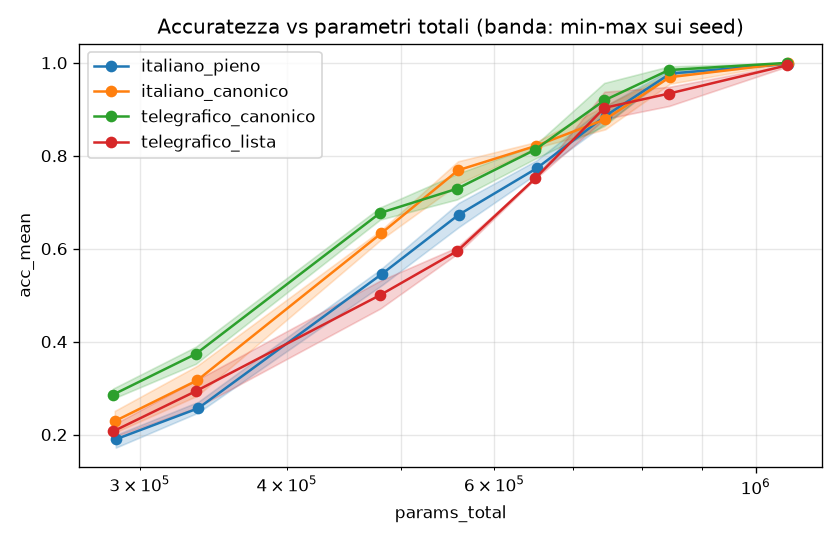
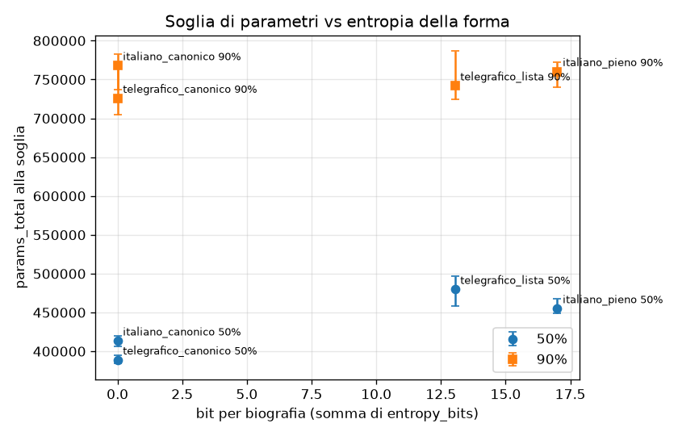

# Esperimento v4: regolarità vs lunghezza (disegno 2×2)

<!-- FINALE -->
**Stato: completato, nessun taglio** (8 taglie × 3 seed × 4 formati, più verifica lr e controlli; ~2,5 h di calcolo,
budget 4 h). Tabelle complete generate automaticamente in [`results/v4/summary_v4.md`](results/v4/summary_v4.md);
CSV e grafici in `results/v4/`.

## Risposta in breve

**Il vantaggio in parametri viene dalla regolarità, non dallo stripping; lo stripping aiuta solo se le forme sono
già regolari e non ambigue. E il vantaggio c'è solo a metà curva (soglia 50%): alla soglia del 90% nessuno dei
quattro formati si distingue dal pieno oltre il rumore.**

- **Soglia 50%** (parametri totali): il formato regolare e strippato (`telegrafico_canonico`) serve **0,85×** i
  parametri del pieno [IC bootstrap 0,83–0,87], cioè −15%. Scomposto in log (Shapley): **regolarità ≈ 97%**
  [82–112%], **stripping ≈ 3%** [−12–18%] del guadagno.
  - Regolarità: canonico/vario = 0,91 a parole piene, 0,81 a parole tolte.
  - Stripping: strippato/pieno = **1,05 con forme varie** (peggiora) e 0,94 con forme canoniche.
  - Interazione 0,89 [0,85–0,94]: gli effetti **non si sommano**; lo stripping cambia segno a seconda della regolarità.
- **Soglia 90%**: tutti i rapporti sono tra 0,95 e 1,01 con intervalli che includono (o sfiorano) 1
  (totale 0,95 [0,92–1,01]). La soglia alta è decisa dalla **data di nascita** (14,3 bit, 29% dell'informazione di una
  biografia), che nessun formato aiuta; la quota regolarità/stripping a questo livello non è definita (effetto
  totale ≈ 0).
- Il risultato spiega v3: strippare l'italiano vario (telegrafico_lista/auto) **non** riduce i parametri perché
  togliendo preposizioni e articoli le forme di attributi diversi collidono (“è nato **il** …” e “è nato **a** …”
  diventano entrambe “nato …”): il 75% delle frasi di data e luogo di nascita ha un prefisso condiviso con l'altro
  attributo. Il guadagno in lunghezza (−30% token) viene annullato dall'ambiguità.

## Fase 0bis: allineamento del vocabolario

Embedding e testa arrotondati al multiplo di 64 superiore (opzione `vocab_pad` in `src/v3/train3.py`); nei CSV
`vocab` e `params_total` usano il V reale, `vocab_padded` e `params_total_padded` quello con padding.

**Micro-benchmark** (0,38M pieno, batch 512, step completo compilato: forward, backward, clip, AdamW;
`results/v4/align_bench.csv`):

| vocabolario | V | multiplo di 64 | step (ms) | solo testa (ms) |
|---|---|---|---|---|
| bpe4096 | 3814 (reale) | no | 11,10 | 4,17 |
| bpe4096 | 3816 | no (multiplo di 8) | 11,02 | 3,25 |
| bpe4096 | 3840 | sì | 11,06 | 3,24 |
| bpe2048 | 2047 | no | 13,08 | 1,90 |
| bpe2048 | 2040 | no (multiplo di 8) | 12,37 | 1,85 |
| bpe2048 | 2048 | sì | 12,90 | 1,88 |

- Isolata, la testa con V=3814 costa +0,9 ms (+29%) rispetto a 3840; basta già un multiplo di 8. **Nello step
  completo la differenza sparisce** (11,10 vs 11,06 ms, entro il rumore): il compilatore la assorbe.
- BPE 2048 è **già multiplo di 64**: i due casi non allineati sono artificiali e non mostrano costi sistematici.
- L'ipotesi di v3 (la testa del “4096” costa molto per il disallineamento) è confermata solo sulla testa isolata;
  non spiega il tempo per step.

**Run di controllo** (0,38M pieno, `results/v4/align_control.csv` e `align_control2.csv`):

| corpus | V modello | seed | accuratezza | riferimento | Δ |
|---|---|---|---|---|---|
| pieno@bpe2048 | 2048 | 0 | 0,663 | 0,676 (run D v3) | −0,012 ✓ |
| pieno@bpe4096 | 3840 (allineato) | 0 / 1 | 0,646 / 0,670 → media 0,658 | | |
| pieno@bpe4096 | 3814 (non allineato, stesso codice) | 0 / 1 | 0,673 / 0,655 → media 0,664 | | −0,006 |

- A 2048 il criterio ±0,02 è rispettato (il padding non cambia nulla: V è già 2048; lo scarto è il rumore tra due
  esecuzioni dello stesso run).
- A 4096 il primo controllo dava −0,027 rispetto a v2 (fuori di poco dal ±0,02); due seed con e senza padding nello
  stesso codice danno −0,006 di media: **il padding non cambia l'accuratezza**, la differenza era rumore tra seed.
  Anche il tempo di training è identico (~100 s).
- In Fase F tutti e quattro i tokenizer hanno V = 2048 esatto: il padding è attivo ma non aggiunge righe.

## Fase F: i quattro formati

Tutti BPE 2048 a cifre singole con tokenizer proprio, pari passi, E200, 20 000 persone, eval su 5000 persone × 6
attributi.

| | parole piene | parole tolte (stripper a lista v3) |
|---|---|---|
| **forme varie** (4 template/attributo, pronomi) | `italiano_pieno` | `telegrafico_lista` |
| **forma canonica** (1 template/attributo) | `italiano_canonico` | `telegrafico_canonico` |

**italiano_canonico**: per ogni attributo il template di `src.data.PIENO` scelto in v3 per le domande della Fase E
(`E_QUESTION_TEMPLATE`), cioè una delle quattro forme del pieno, grammaticale e con accordo di genere. **Regola del
soggetto**: nome completo nella prima frase, soggetto **sempre omesso** nelle altre (nessun pronome); ordine delle
frasi mescolato come negli altri formati. Esempio (stessa persona, `results/v4/F_examples.md` ne ha 2 per formato):

- **italiano_pieno**: Francesca Calderoni ha come data di nascita il 31 ottobre 1964. Lei lavora per Intimissimi. Lei ha i natali a Lanciano. Lei esercita la professione di anestesista. Lei ha fatto gli studi presso Università di Foggia. Ha conseguito il titolo in Statistica.
- **italiano_canonico**: Francesca Calderoni ha studiato presso Università di Foggia. Si è laureata in Statistica. Ha come data di nascita il 31 ottobre 1964. È originaria di Lanciano. Ha lavorato presso Intimissimi. Esercita la professione di anestesista.
- **telegrafico_lista**: Francesca Calderoni come data nascita 31 ottobre 1964. lavora Intimissimi. natali Lanciano. esercita professione anestesista. fatto studi Università Foggia. conseguito titolo Statistica.
- **telegrafico_canonico**: Francesca Calderoni studiato Università Foggia. Si laureata Statistica. come data nascita 31 ottobre 1964. originaria Lanciano. lavorato Intimissimi. Esercita professione anestesista.

**Misure prima del training** (`results/v4/F_forms.csv`, `F_ambiguity.csv`):

| formato | token/bio | forme per attributo (M, frasi non iniziali) | forme distinte per attributo (tutte) | entropia delle forme (bit/bio) | frasi con prefisso condiviso tra attributi |
|---|---|---|---|---|---|
| italiano_pieno | 57,6 | 8 | 16–20 | **17,0** | 0% |
| italiano_canonico | 55,8 | 1 | 2–4 | **0** | 0% |
| telegrafico_lista | 40,5 | 4–6 | 8–12 | **13,0** | 25% (75% di data e luogo) |
| telegrafico_canonico | 41,5 | 1 | 2–4 | **0** | 0% |

- Entropia = media per biografia di −log₂ p(forma | attributo, genere, prima frase): bit dovuti a template, pronome e
  maiuscola, esclusi l'ordine delle frasi e il genere (fissato dalla persona). Pieno: 2 bit per la prima frase
  (4 template) e 3 per le altre (× pronome sì/no) → 17 bit esatti.
- Il canonico ha quasi la stessa lunghezza del pieno (−3% token): la riga del 2×2 cambia davvero solo la varietà.
  Lo stripping toglie il 26–30% dei token in entrambe le righe.
- Lo stripping del pieno toglie soprattutto i pronomi (17 → 13 bit) ma **crea collisioni**: “è nato il / ha visto
  la luce il / ha i natali il” (data) e “è nato a / ha visto la luce a / ha i natali a” (luogo) diventano le stesse
  forme “nato / visto luce / natali”.
- **Domande**: stessa domanda per i 4 formati (nome + prefisso del template canonico), strippata nei telegrafici.
  Il test automatico `forms4.prompt_conflicts` (in `tests/v4/test_forms4.py`, eseguito anche prima del training dal
  piano) verifica che il prompt sia nativo (prima frase reale del corpus) e che non sia prefisso di una forma di un
  altro attributo: nessun conflitto nei 4 formati.
- **Verifica lr** (italiano_canonico, 0,38M, seed 0): 1× 0,628, **2× 0,739**, 4× 0,685 → resta il lr di v2. Le
  taglie nuove usano il lr della taglia v2 più vicina in log-parametri: 2× fino a 0,52M, 1× da 0,60M.

## Risultati

### Soglie in parametri totali (media di 3 seed; IC bootstrap 95% sui seed; min-max dei singoli seed)

| formato | 50% | IC | seed min-max | vs pieno | 90% | IC | seed min-max | vs pieno |
|---|---|---|---|---|---|---|---|---|
| italiano_pieno | 455k | 449–468k | 448–468k | 1,00 | 760k | 741–773k | 740–771k | 1,00 |
| italiano_canonico | 413k | 407–419k | 410–418k | **0,91** | 768k | 737–782k | 737–780k | 1,01 |
| telegrafico_lista | 480k | 458–497k | 456–496k | **1,05** | 742k | 724–787k | 724–774k | 0,98 |
| telegrafico_canonico | 389k | 384–394k | 383–394k | **0,85** | 726k | 705–772k | 703–771k | 0,95 |

Con l'accuratezza pesata per l'entropia dei fatti (frazione di bit memorizzati, `F_thresholds_bits.csv`) i rapporti
sono gli stessi: 50% 0,91 / 1,07 / 0,86; 90% 1,02 / 0,97 / 0,97.

### Scomposizione 2×2 (rapporti di parametri totali, IC bootstrap)

| | 50% | 90% |
|---|---|---|
| regolarità a parole piene (canonico / pieno) | **0,91** [0,88–0,93] | 1,01 [0,97–1,04] |
| regolarità a parole tolte (tel. canonico / tel. lista) | **0,81** [0,78–0,85] | 0,98 [0,91–1,04] |
| stripping a forme varie (tel. lista / pieno) | **1,05** [1,01–1,10] | 0,98 [0,95–1,04] |
| stripping a forma canonica (tel. canonico / canonico) | **0,94** [0,92–0,96] | 0,95 [0,91–1,01] |
| interazione (rapporto dei rapporti) | **0,89** [0,85–0,94] | 0,97 [0,89–1,03] |
| totale (tel. canonico / pieno) | **0,85** [0,83–0,87] | 0,95 [0,92–1,01] |
| quota regolarità (Shapley, log) | **97%** [82–112%] | non definita |
| quota stripping | **3%** [−12–18%] | non definita |

Lettura: al 50% la regolarità vale da sola −9% a parole piene e −19% a parole tolte; lo stripping vale +5% con forme
varie e −6% con forme canoniche. Gli effetti interagiscono (0,89): in media lo stripping non porta quasi nulla, ma
tolte le parole la regolarità conta il doppio. Al 90% nessuna cella è chiaramente diversa da 1.

### Per attributo: quali fatti beneficiano della regolarità

Soglia in parametri totali per attributo e rapporto canonico/vario nella stessa colonna del 2×2 (`F_attr.csv`):

| attributo (bit) | pieno 50% | canonico/pieno 50% | 90% | tel. lista 50% | tel. canonico/lista 50% | 90% |
|---|---|---|---|---|---|---|
| data di nascita (14,3) | 747k | 1,03 | 1,09 | 675k | 1,08 | 1,03 |
| luogo di nascita (7,6) | 472k | 1,06 | **0,82** | 683k | **0,70** | **0,66** |
| università (6,9) | 423k | 0,99 | 0,93 | 297k | 1,35 | 1,05 |
| corso (6,9) | 349k | 0,89 | 0,93 | 290k | 1,00 | 1,00 |
| professione (6,9) | 523k | **0,71** | **0,70** | 533k | **0,53** | **0,53** |
| azienda (7,3) | 343k | 0,93 | 1,02 | 421k | 0,87 | 0,82 |

- **Professione** è il fatto che guadagna di più (−30% pieno, −47% strippato): nel pieno ha il template “è {v}”, il
  cui prefisso “è” è l'inizio anche di “è nato / è originario / è impiegato”; nel telegrafico vario “Lui è
  farmacista” diventa “farmacista”, senza alcun marcatore di relazione.
- **Luogo di nascita**: nel telegrafico vario collide con la data (sopra); la forma canonica (“originario”) lo
  riporta da 683k a 480k al 50%.
- **Data di nascita**: la regolarità non aiuta (1,03–1,09). È il fatto più informativo, l'ultimo a essere imparato in
  tutti i formati (nessuno arriva al 50% su questo attributo prima di ~675k), e decide la soglia del 90% della media.
  Ipotesi non verificata: il costo della data è la memorizzazione delle cifre, non la forma della frase; il template
  canonico scelto (“ha come data di nascita il”) è inoltre il più lungo dei quattro.

### Tempo di training al 90% (interpolato, media sui seed)

| formato | parametri al 90% | tempo | vs pieno |
|---|---|---|---|
| italiano_pieno | 760k | 137 s | 1,00 |
| italiano_canonico | 768k | 118 s | 0,86 |
| telegrafico_lista | 742k | 90 s | 0,66 |
| telegrafico_canonico | 726k | 76 s | 0,55 |

Qui lo stripping conta più della regolarità: −30% di token per biografia a pari passi significa step più corti.

### Entropia delle forme e parametri necessari

Con 4 punti la relazione è solo qualitativa: al 50% i due formati a 0 bit (413k, 389k) stanno sotto i due formati a
13–17 bit (480k, 455k), ma l'ordine dentro le coppie non segue l'entropia: telegrafico_lista ha meno bit del pieno
(13 vs 17) e serve più parametri. La variabile mancante è l'**ambiguità tra attributi** (forme uguali per relazioni
diverse), che lo stripping del testo vario introduce: conta la regolarità *per relazione*, non il numero di forme in
sé. Al 90% la soglia non dipende dall'entropia delle forme (726–768k per tutti).

## Conclusione

**Il vantaggio in parametri viene dalla regolarità.** Alla soglia del 50%, a parità di vocabolario, la forma canonica
riduce i parametri totali del 9% a parole piene e del 19% a parole tolte; lo stripping da solo li aumenta del 5% sul
testo vario e li riduce del 6% su quello canonico. Scomponendo il −15% del formato regolare e strippato, **~97% è
regolarità e ~3% stripping** (IC: 82–112% contro −12–18%); i due effetti non sono additivi (interazione 0,89): togliere
parole è utile solo se non cancella le parole che distinguono una relazione dall'altra. Questo spiega perché in v3 il
telegrafico a template riduceva i parametri (~10%) e lo stesso testo strippato dall'italiano no.

Il vantaggio però riguarda la parte centrale della curva: **alla soglia del 90% nessun formato è distinguibile dal
pieno** (0,95–1,01), perché l'ultimo fatto da imparare, la data di nascita, non beneficia né della regolarità né
dello stripping. Lo stripping resta utile per il **tempo di training** (0,55–0,66× al 90%), la regolarità molto meno
(0,86×).

## Limiti e deviazioni

- **Riuso di run v3**: 12 run del pieno (seed 0 e 1, 6 taglie già in v3, V=2048 già allineato) sono riusati e
  rivalutati con la domanda v4 (stage `D_main_reeval`; |Δ accuratezza| ≤ 0,011). Il controllo identico dà −0,012:
  stesso ordine del rumore tra esecuzioni. I loro tempi di training vengono dalla sessione v3 (il run di controllo
  ripete lo stesso tempo, 104,9 vs 104,8 s).
- **Taglia 0,52M**: con head_dim 16 non esiste una configurazione a 4 layer vicina a 0,52M; usata 4×104 con **13 teste
  da 8**. Accuratezza in linea con le taglie vicine, ma training più lento (~115–156 s contro ~85–100 s di 0,45M),
  che entra nell'interpolazione del tempo al 90%.
- **lr**: verifica solo per il canonico a 0,38M (conferma 2×); le taglie nuove ereditano il lr della taglia v2 più
  vicina, con il salto da 2× a 1× tra 0,52M e 0,60M (come in v2/v3), proprio nella zona della soglia del 90%.
- **Scelta del template canonico**: uno solo dei possibili (quello delle domande v3, scelto per l'univocità dopo lo
  stripping). La regolarità è confusa con la scelta di quel template; in particolare il risultato sulla data potrebbe
  dipendere dal template lungo. Non provati altri canonici.
- **IC con 3 seed**: il bootstrap ricampiona 3 valori per taglia e sottostima l'incertezza; anche il min-max dei seed
  va letto come indicativo. Gli effetti al 90% sono sotto la risoluzione di 3 seed.
- **Quote al 90%**: con effetto totale ≈ 0 la scomposizione in quote non ha senso (IC da −377% a +305%) ed è riportata
  come non definita.
- **Entropia**: misura solo la scelta di template, pronome e maiuscola; l'ambiguità tra attributi è stata misurata a
  posteriori (`F_ambiguity.csv`, collisioni di prefissi identici; non conta i prefissi che sono inizio di altri, come
  “è” nel pieno).
- **Allineamento**: in Fase F non ha avuto effetto (V = 2048 per tutti); i run di controllo a 4096 sono 2 seed per
  condizione.
